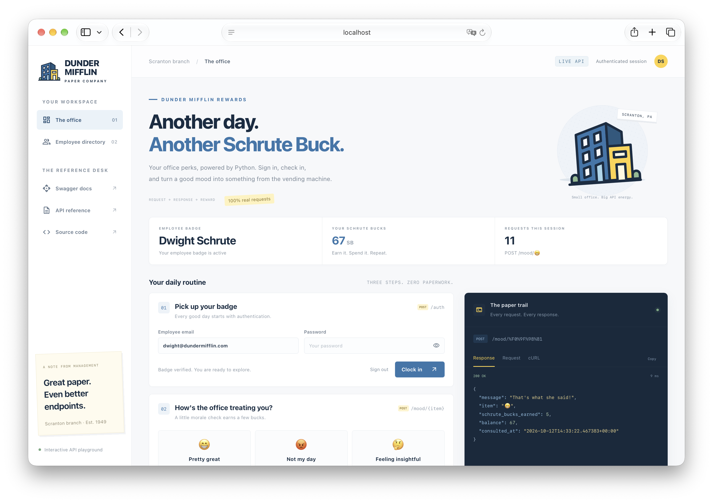

<div align="center">

# Rewards UI

An interactive playground for [rewards-api](../rewards-api).<br>
Clock in, earn and spend Schrute Bucks, and inspect every request and response.


[Quick Start](#quick-start) · [Requested Endpoints](#requested-endpoints) · [Configuration](#configuration) · [Rewards API](../rewards-api/README.md)

</div>

Part of [FastAPI Lab](../../README.md).

## Quick Start

A static page with no build step.  
Start [`rewards-api`](../rewards-api/README.md#getting-started), then open the playground.

Terminal 1, start the API (it keeps running):

```bash
cd pocs/rewards-api && make run
```

Terminal 2, from `pocs/rewards-ui`, open the playground:

```bash
open index.html
```

> [!NOTE]
> Opened from disk, the page sends `Origin: null`.
> That is why `rewards-api` lists `"null"` in `CORS_ORIGINS` ([`settings.toml`](../rewards-api/resources/settings.toml)).



## Requested Endpoints

| Action | Endpoint |
|:---|:---|
| **Log in** | `POST /auth` |
| **Daily check-in** | `POST /mood/{mood}` |
| **Vending catalog** | `GET /vending/` |
| **Inspect item** | `GET /vending/{item}` |
| **Redeem item** | `POST /vending/{item}` |
| **My profile** | `GET /users/me` |
| **Lookup by ID** | `GET /users/{user_id}` |
| **New employee** | `POST /users/` |

## Configuration

| Constant | Default | Location |
|:---|:---|:---|
| `API_URL` | `http://localhost:8000` | [`app.js`](app.js) |

> **PS.:** This is an unofficial fan project for learning FastAPI, not affiliated with or endorsed by NBCUniversal.
